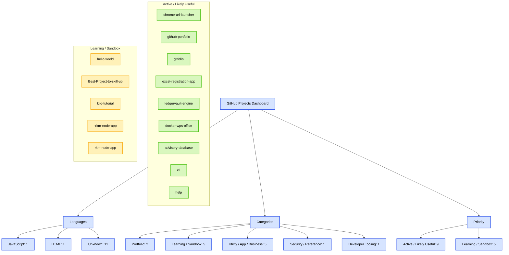

# 📊 GitHub Project Master Dashboard

A quick overview of all repositories associated with this GitHub account, organized by language, project category, and priority.

## 🧭 Executive Summary

- Total repositories: 14
- Active / likely useful: 9
- Learning / sandbox: 5
- Portfolio projects: 2
- Utility / app projects: 5
- Security / reference: 1
- Developer tooling: 1

## 📈 By Language

| Language | Count |
|---|---:|
| JavaScript | 1 |
| HTML | 1 |
| Unknown | 12 |

## 🗂️ By Category

| Category | Count |
|---|---:|
| Portfolio / Developer Website | 2 |
| Learning / Sandbox | 5 |
| Utility / App / Business | 5 |
| Security / Reference | 1 |
| Developer Tooling | 1 |

## ✅ Active / Likely Useful

| Repo | Language | Category |
|---|---|---|
| chrome-url-launcher | JavaScript | Utility / Browser Tool |
| github-portfolio | HTML | Portfolio / Personal Website |
| gitfolio | Unknown | Portfolio / Developer Website |
| excel-registration-app | Unknown | Business App / Registration Tool |
| ledgervault-engine | Unknown | Utility / Bookmark Organizer |
| docker-wps-office | Unknown | Container / Desktop App |
| advisory-database | Unknown | Security Data / Reference Database |
| cli | Unknown | Developer Tool / CLI |
| help | Unknown | Support / Issue Tracking Repo |

## 🧪 Learning / Sandbox

| Repo | Language | Category |
|---|---|---|
| hello-world | Unknown | Learning / GitHub Practice |
| Best-Project-to-skill-up | Unknown | Learning / Practice Project |
| kilo-tutorial | Unknown | Learning / Tutorial Project |
| -rkm-node-app | Unknown | Node.js App / Learning Project |
| rkm-node-app | Unknown | Node.js App / Learning Project |

## 📋 Full Repository List

| Repo | Language | Category | Priority | Status |
|---|---|---|---|---|
| chrome-url-launcher | JavaScript | Utility / Browser Tool | Active / Likely Useful | Active |
| github-portfolio | HTML | Portfolio / Personal Website | Active / Likely Useful | Active |
| gitfolio | Unknown | Portfolio / Developer Website | Active / Likely Useful | Active |
| excel-registration-app | Unknown | Business App / Registration Tool | Active / Likely Useful | Active |
| ledgervault-engine | Unknown | Utility / Bookmark Organizer | Active / Likely Useful | Active |
| docker-wps-office | Unknown | Container / Desktop App | Active / Likely Useful | Active |
| advisory-database | Unknown | Security Data / Reference Database | Active / Likely Useful | Active |
| cli | Unknown | Developer Tool / CLI | Active / Likely Useful | Active |
| help | Unknown | Support / Issue Tracking Repo | Active / Likely Useful | Active |
| hello-world | Unknown | Learning / GitHub Practice | Learning / Sandbox | Learning |
| Best-Project-to-skill-up | Unknown | Learning / Practice Project | Learning / Sandbox | Learning |
| kilo-tutorial | Unknown | Learning / Tutorial Project | Learning / Sandbox | Learning |
| -rkm-node-app | Unknown | Node.js App / Learning Project | Learning / Sandbox | Learning |
| rkm-node-app | Unknown | Node.js App / Learning Project | Learning / Sandbox | Learning |

## 📄 CSV

```csv
repo,language,category,priority,status,owner_label,notes
"chrome-url-launcher","JavaScript","Utility / Browser Tool","Active / Likely Useful","Active","Personal Project","Simple Chrome URL launcher utility"
"github-portfolio","HTML","Portfolio / Personal Website","Active / Likely Useful","Active","Personal Project","Personal website / portfolio"
"gitfolio","Unknown","Portfolio / Developer Website","Active / Likely Useful","Active","Personal Project","Developer portfolio template"
"excel-registration-app","Unknown","Business App / Registration Tool","Active / Likely Useful","Active","Possible Business App","Registration or workflow application"
"ledgervault-engine","Unknown","Utility / Bookmark Organizer","Active / Likely Useful","Active","Personal Utility","Bookmark organizer / information utility"
"docker-wps-office","Unknown","Container / Desktop App","Active / Likely Useful","Active","Personal Tool","Dockerized WPS Office environment"
"advisory-database","Unknown","Security Data / Reference Database","Active / Likely Useful","Active","Reference Project","Security advisories and CVE-related references"
"cli","Unknown","Developer Tool / CLI","Active / Likely Useful","Active","Developer Tooling","CLI-focused project"
"help","Unknown","Support / Issue Tracking Repo","Active / Likely Useful","Active","Support Project","Likely support or issue tracking repository"
"hello-world","Unknown","Learning / GitHub Practice","Learning / Sandbox","Learning","Learning Repo","Beginner GitHub practice repo"
"Best-Project-to-skill-up","Unknown","Learning / Practice Project","Learning / Sandbox","Learning","Learning Repo","Practice project for improving web development"
"kilo-tutorial","Unknown","Learning / Tutorial Project","Learning / Sandbox","Learning","Learning Repo","Tutorial-based text editor project"
"-rkm-node-app","Unknown","Node.js App / Learning Project","Learning / Sandbox","Learning","Learning Repo","Small Node.js learning or sandbox project"
"rkm-node-app","Unknown","Node.js App / Learning Project","Learning / Sandbox","Learning","Learning Repo","Node.js exploratory or learning project"
```

## 🧩 Mermaid Diagram



## 📝 Notion Block

```markdown
# 📊 Project Dashboard

## 🧭 Overview
- Total repositories: 14
- ✅ Active / likely useful: 9
- 🧪 Learning / sandbox: 5
- 🔵 Portfolio projects: 2
- 🛠️ Utility / app projects: 5
- 🔒 Security / reference: 1
- ⚙️ Developer tooling: 1

## ✅ Active / Likely Useful
- chrome-url-launcher
- github-portfolio
- gitfolio
- excel-registration-app
- ledgervault-engine
- docker-wps-office
- advisory-database
- cli
- help

## 🧪 Learning / Sandbox
- hello-world
- Best-Project-to-skill-up
- kilo-tutorial
- -rkm-node-app
- rkm-node-app

## 🔵 Portfolio
- github-portfolio
- gitfolio

## 🛠️ Utilities / Apps
- chrome-url-launcher
- excel-registration-app
- ledgervault-engine
- docker-wps-office
- help

## 🔒 Security / Reference
- advisory-database

## ⚙️ Developer Tooling
- cli

## 📈 Category Breakdown
| Category | Count |
|---|---:|
| Portfolio / Developer Website | 2 |
| Learning / Sandbox | 5 |
| Utility / App / Business | 5 |
| Security / Reference | 1 |
| Developer Tooling | 1 |
```

## 📝 Notes

This dashboard separates active, practical work from learning or sandbox repositories and gives a quick look at how the account is organized across portfolio, utility, security, and educational projects.

---

This repository is ready for a GitHub portfolio dashboard view and can also be reused as a project tracking document for internal or public-facing documentation.
